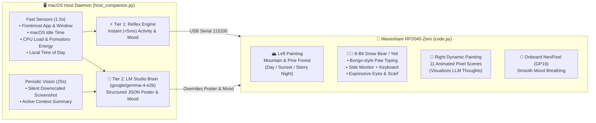

# 🐾 RP2040-Zero 8-Bit Desk-Buddy Companion

An expressive, **100% visual 8-bit pixel-art desktop companion** powered by a **Waveshare RP2040-Zero**, a **0.96" ST7735R IPS display (160×80)**, and a **local Vision/Text LLM** (`google/gemma-4-e2b`, `SmolVLM2-2.2B`, or `Qwen2.5-VL-3B`) running via **LM Studio** on macOS.

Sitting in a cozy pixel-art room behind a wooden desk with a side-angled monitor, mechanical keyboard, steaming mug of coffee, and a potted cactus, a fluffy **8-Bit Snow Bear / Yeti** reacts in real time to your workflow, system load, Pomodoro stamina, time of day, and screen context — expressing its "thoughts" through a **Dynamic Wall Painting** rather than text clutter.

---

## ✨ Features & Visual Architecture



### How to Read the Scene (Zero Text Clutter!)

1. **🐻‍❄️ Center Stage — 8-Bit Snow Bear / Yeti at the Desk:**
   - **Scarf Color** reflects the companion's current emotional state:
     - 🔵 **Blue (`focused`)** — Deep in coding or terminal flow
     - 🟢 **Emerald (`happy`)** — Productive streak, shipping code, positive balance
     - 🟣 **Purple (`vibing` + 8-bit headphones)** — Listening to Spotify / Apple Music
     - ⚪ **Slate Gray (`tired` / `sleepy`)** — Low Pomodoro energy or sleeping (`idle > 3 min`)
     - 🔴 **Crimson (`stressed` / `panicking` + sweat drop)** — High CPU load (`> 85%`) or debugging errors
   - **Mechanical Keyboard & Side Monitor:** When you code or type in the terminal, the Yeti's fluffy paws rapidly tap the mechanical keyboard with pixel sparks while code lines scroll on the side monitor.
   - **Pomodoro Energy Crystal (`x=97..101`):** A compact vertical crystal gauge on the desk shows your remaining stamina (`Green → Gold → Red`). It slowly drains during continuous work and recharges when you step away for a break.

2. **🎨 Right Wall — Dynamic Thought Painting (`POSTER`):**
   An ornate gold-trimmed frame (`42×32` canvas) with a gallery lamp above it. Both the fast reflex engine and the local LLM change the painting to visualize what is happening on your Mac:

   | Painting ID (`POSTER`) | Animated 8-Bit Artwork | Context / Trigger |
   | :--- | :--- | :--- |
   | `code_matrix` | Falling green Matrix rain + 3D terminal window | Writing code in VS Code / Cursor / Zed or working in Terminal |
   | `bug_alert` | Flashing crimson alert + wiggling 8-bit beetle & `!` sign | Debugging stack traces, compiler errors, or bug hunting |
   | `brain_idea` | Glowing golden lightbulb with radiating sparks | Brainstorming with AI, reading documentation, architecture |
   | `coffee_need` | Steaming espresso cup on a wooden cafe table | Low Pomodoro energy (`< 28%`) — time to grab a coffee break! |
   | `fire_panic` | Roaring multi-shade pixel flames | Heavy CPU load (`> 85%`), intense compilation, or stress |
   | `music_eq` | Animated neon equalizer bars | Listening to music / audio apps |
   | `chill_play` | Retro red monitor with a white `Play` triangle | Watching YouTube, videos, or taking a casual browsing break |
   | `rocket_launch` | Pixel rocket blasting through stars with exhaust fire | Deploying, opening/merging PRs, or shipping features |
   | `heart_love` | Beating glossy RPG heart container | Great work-life balance and happy mood |
   | `zzz_dream` | Starry night sky with golden moon & drifting cloud | Mac is idle (`> 3 min`), companion is sleeping |
   | `zen_mountain` | Mt. Fuji sunset landscape | Calm reading or peaceful web browsing |

3. **🏔️ Left Wall — Time-of-Day Mountain & Pine Forest Landscape:**
   A second framed landscape painting (`40×32` canvas) showing snow-capped dual mountain peaks and a tiered evergreen pine forest that automatically matches your local clock (`HOUR:0..23`):
   - **☀️ Daytime (`07:00 – 17:59`):** Bright blue sky, golden sun, and a slowly drifting white cloud behind the snowy peaks.
   - **🌅 Sunset (`18:00 – 20:59`):** Warm pink-and-gold evening horizon with a setting sun.
   - **🌙 Night (`21:00 – 06:59`):** Deep midnight sky with a crescent moon and twinkling stars.
   - **⚡ CPU Storm (`CPU >= 85%`):** Stormy crimson sky with flashing pixel lightning.

---

## 🔌 Hardware & Wiring

- **Microcontroller:** Waveshare RP2040-Zero (with onboard WS2812 RGB NeoPixel on `GP16`)
- **Display:** 0.96" ST7735R IPS LCD (`160×80`, SPI interface)

| Display Pin | RP2040-Zero Pin | Function |
| :--- | :--- | :--- |
| `VCC` | `3V3` | 3.3V Power |
| `GND` | `GND` | Ground |
| `SCL` / `SCK` | `GP2` | SPI Clock |
| `SDA` / `MOSI` | `GP3` | SPI Data (MOSI) |
| `RES` / `RST` | `GP4` | Display Reset |
| `DC` | `GP1` | Data / Command Select |
| `CS` | `GP0` | Chip Select |
| `BLK` / `BL` | `GP5` | Backlight Control |
| *(Onboard LED)* | `GP16` | WS2812 RGB NeoPixel Mood Light |

---

## 🖥️ Multi-OS Native Support (macOS, Linux, Windows)

`host_companion.py` runs natively across **macOS**, **Linux**, and **Windows** with automatic OS detection:

| Feature | 🍎 macOS (`darwin`) | 🐧 Linux (`linux`) | 🪟 Windows (`win32`) |
| :--- | :--- | :--- | :--- |
| **USB Serial Port** | USB VID `0x2E8A` / `/dev/cu.usbmodem*` | USB VID `0x2E8A` / `/dev/ttyACM*` | USB VID `0x2E8A` / `COM*` |
| **Active Window & App** | `osascript` (`System Events`) | `hyprctl` (Hyprland), `swaymsg` (Sway), `xdotool`/`xprop` (X11) | `ctypes.windll.user32` (`GetForegroundWindow`) |
| **Idle Time Sensor** | `ioreg -c IOHIDSystem` (`HIDIdleTime`) | `xprintidle` (X11) / `gdbus` (`Mutter.IdleMonitor`) | `ctypes.windll.user32.GetLastInputInfo` |
| **Screenshot (Vision)** | `Pillow.ImageGrab` / `screencapture` + `sips` | `Pillow.ImageGrab` / `grim` / `scrot` / `gnome-screenshot` | `Pillow.ImageGrab` |

---

## 🚀 Quick Start

### 1. Flash the RP2040-Zero Firmware
1. Install **CircuitPython 9.x** for **Waveshare RP2040-Zero** (available in [GitHub Releases](../../releases) as `circuitpython-waveshare-rp2040-zero.uf2`).
2. Make sure `adafruit_st7735r` and `neopixel` are in `CIRCUITPY/lib/`.
3. Copy [`code.py`](file:///Users/booo/projects/embeded/esp32-activity-pet/code.py) to the root of your `CIRCUITPY` drive.

### 2. Start LM Studio Local Server
1. Open **LM Studio** (macOS, Linux, or Windows).
2. Load a lightweight 1B–2B Vision or Text model (recommended: **`google/gemma-4-e2b`** or **`SmolVLM2-2.2B-Instruct`**).
3. Start the **Local Server** on port `1234` (`http://127.0.0.1:1234/v1`).

### 3. Run the Host Daemon
**Option A — Using pre-built release artifacts from [Releases](../../releases):**
```bash
# Standalone Linux binary:
chmod +x ./desk-buddy-host-linux-x86_64
./desk-buddy-host-linux-x86_64

# Universal executable bundle (macOS / Linux / Windows):
python3 ./desk-buddy-host-universal.pyz
```

**Option B — Running from Python source (macOS / Linux / Windows):**
```bash
python3 -m venv venv
source venv/bin/activate  # On Windows: venv\Scripts\activate
pip install -r requirements.txt
python host_companion.py
```

**Option C — Install as an Automatic Background Service (macOS `launchd` / Linux `systemd`):**
```bash
# Starts automatically on login and restarts if unplugged/replugged:
python3 host_companion.py --install-service

# To remove the background service later:
python3 host_companion.py --uninstall-service
```

**Option D — Running in Docker (`Dockerfile` + `docker-compose.yml`):**
```bash
# Native USB & X11 passthrough on Linux (or TCP serial bridge on macOS/Windows):
docker compose up -d --build
```

#### Useful CLI Flags:
- `--port /dev/ttyACM0` (or `--port COM3`) — Override automatic serial port detection.
- `--once` — Run a single sensor + LLM cycle and exit (great for testing).
- `--no-vision` — Disable screenshots and run in ultra-lightweight text-only mode (uses window titles & system metrics only).
- `--llm-interval 25` — Customize seconds between LLM subconscious checks (reflexes always run every `1.5s`).
- `--lm-url http://127.0.0.1:1234/v1` — Custom OpenAI-compatible local server URL.

---

## ⚙️ CI/CD & How to Configure Your GitHub Repository

This repository includes an automated GitHub Actions pipeline in [`.github/workflows/release.yml`](file:///Users/booo/projects/embeded/esp32-activity-pet/.github/workflows/release.yml) running on **`ubuntu-latest` with `python-version: "3.x"` (latest Python)** that:
1. Validates Python syntax for both `code.py` and `host_companion.py`.
2. **Automatically creates and pushes a semantic Git tag (`vX.Y.Z`)** whenever features/fixes are pushed or merged into `main`:
   - Commits starting with `feat:` or containing `feature` / `add` bump the **minor** version (`v1.1.0`, `v1.2.0`, …).
   - Commits containing `BREAKING CHANGE` or `!:` bump the **major** version (`v2.0.0`).
   - All other code commits bump the **patch** version (`v1.0.1`, `v1.0.2`, …).
3. Compiles [`host_companion.py`](file:///Users/booo/projects/embeded/esp32-activity-pet/host_companion.py) into a **standalone Linux binary (`desk-buddy-host-linux-x86_64`)** via `PyInstaller` and a **universal cross-platform executable (`desk-buddy-host-universal.pyz`)**.
4. Packages the RP2040-Zero firmware (`rp2040-zero-desk-buddy-firmware.zip` + CircuitPython `.uf2` + `SHA256SUMS.txt`) and **publishes a new GitHub Release** automatically.

### Required GitHub Repository Setup (3 Simple Steps):
1. **Create a GitHub repository** and push your `main` branch:
   ```bash
   git add .
   git commit -m "feat: initial 8-bit Snow Bear Desk-Buddy and Gemma 4 E2B daemon"
   git branch -M main
   git remote add origin https://github.com/<your-username>/<your-repo>.git
   git push -u origin main
   ```
2. **Enable Workflow Write Permissions** (so GitHub Actions is allowed to create tags and publish Releases):
   - Go to your repository on GitHub → **Settings** → **Actions** → **General**.
   - Scroll down to **Workflow permissions**.
   - Select **"Read and write permissions"** and click **Save**.
3. **Triggering Releases:**
   - Every push or merged Pull Request to `main` that modifies code files (`code.py`, `host_companion.py`, `requirements.txt`, etc.) will automatically tag the commit, build the binary on macOS, and publish a GitHub Release.
   - You can also trigger a release manually at any time under the **Actions** tab → **Build & Release Desk-Buddy** → **Run workflow** (with a dropdown to choose `auto`, `minor`, `patch`, or `major`).

---

## 🤝 Contributing, Ideas & Collaboration

Have a cool idea for a new 8-bit wall painting, a new character skin, additional system sensors, or support for other microcontrollers (ESP32, Pico W, etc.)? **Contributions of all kinds are warmly welcome!**

- 💡 **Got an idea or feature request?** Open an [Issue](../../issues) or start a discussion to share your thoughts!
- 🛠️ **Want to build and contribute directly?** Feel free to fork the repository and open a **Pull Request (PR)** — whether it's a new pixel-art sprite, a new poster scene, or a host daemon improvement.
- 💬 **Want to collaborate or brainstorm together?** Reach out directly via GitHub Issues/Discussions or contact the author — let's build the coziest open-source desk companion together!
